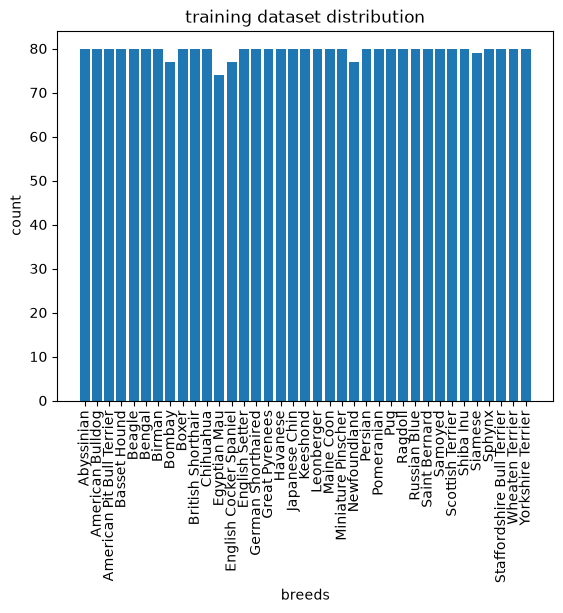
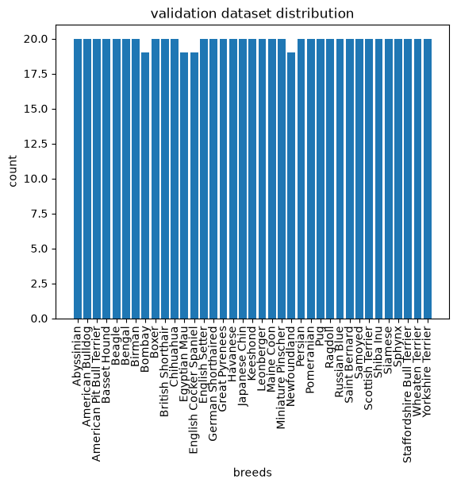
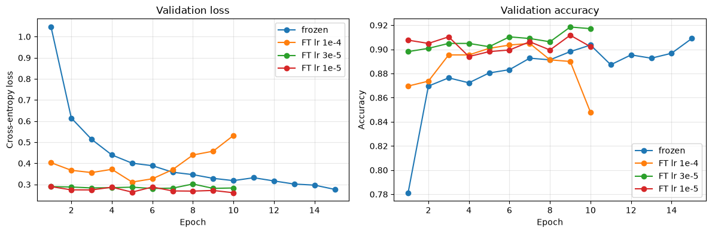
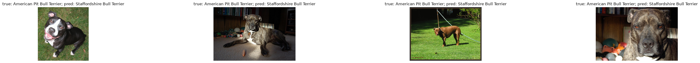
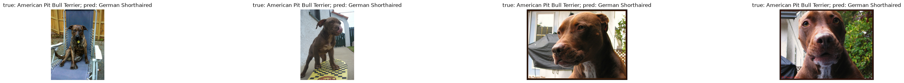
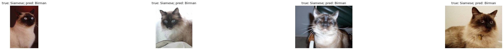
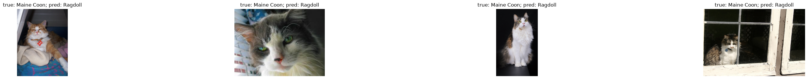
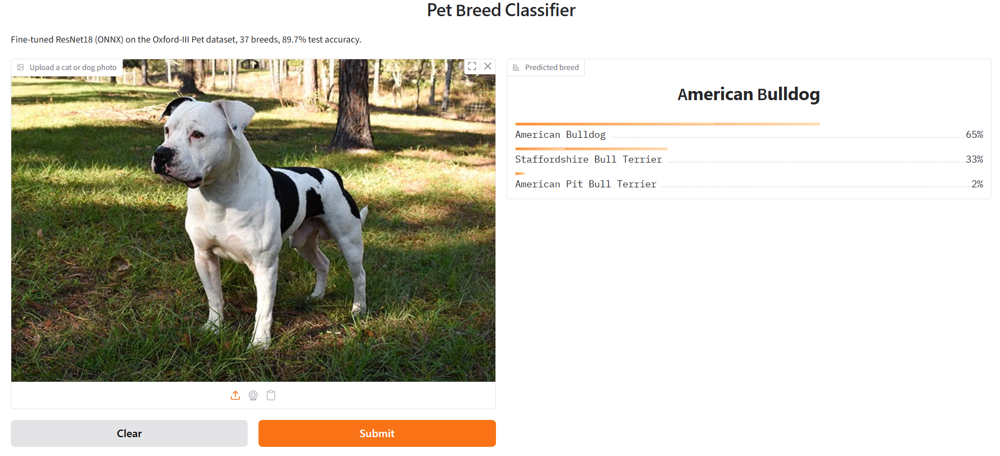

# Pet Breed Classification - Technical Report

## 1. Task and Summary
-Task: fine-grained classification of 37 cat and dog breeds(Oxford-IIIT Pet).
-Approach: transfer learning with ImageNet-pretrzined ResNet18
-Headline result: 89.7% test accuracy (vs 87.9% frozen baseline); deployed as ONNX in a Gradio demo
-key findings:overfitting controlled by backbone LR; errors concentrated in visually similar breed groups; INT8 = 4x smaller, no accuracy loss.

## 2. Data
-Dataset: trainval 3680 / test 3669 images, 37 classes, nearly balanced (88-100 test images per class)
-EDA findings: image sizes vary:
          width       height        ratio
count  3680.000000  3680.000000  3680.000000
mean    431.033424   383.420380     0.934880
std     126.328303   116.833678     0.315808
min     114.000000   108.000000     0.390000
25%     333.000000   333.000000     0.684000
50%     500.000000   375.000000     0.750000
75%     500.000000   500.000000     1.278772
max    3264.000000  2606.000000     1.937984

Dataset has similar looking breeds (ragdoll-Birman)

-Split: stratified 80/20 train/val from trainval (2944 / 736), seed 0 for reproducibility, test set untouched untill the end. i have used stratified split to be sure that in both train and validation sets every class is evenly represented:

Preprocessing: train = RandomResizedCrop(224, scale 0.6-1.0) + horizontal flip + ImageNet Normalisation - as we have many similar breeds, i decided to use scale 0.6-1.0 so at least 60% of original image area would be in frame for training, otherwise it might be very hard for model to learn differencies between breeds, Imagenet normalisation is used for ResNet18 training so i used same normalisation. we need flipping so model learns from characteristics and not overfits if only one kind of pictures are presented for particular breed. also breed looks the same mirrored, so flipping adds variety without channging the label
eval = resize 256 ->center crop 224 -> normalisation, we don't need augmentation here because we are trying to evaluate how model can generalize on natural pictures it is supposed to work.

## 3.Model
- ResNet18 pretrained on Imagenet; final layer replaced: 512 -> 37. ~11.2M parameters; -  i have decided to work on Oxford-IIIT Pet and  when i found out that it only had ~3.7k training examples, my natural decision was  to use pretrained model, because with this amount of data it would be almost impossible to train my own model and get decent results. 100 example per class is pretty low and model would overfit badly. so i decided to use Resnet18 that is small, fast, has strong pretrained features.
Loss: cross-entropy. Sanity check; initial loss ~ ln(37) 3.61 (got 3.76)

# 4. Experiments
- Exp 1 frozen backbone, train head only(Adam, lr 1e-3, 15 epochs)
- Exp 2-4: full fine-tuning starting from the Exp 1 head;
backbone:
  exp 2 - LR 1e-4
  exp 3 - LR 3e-5
  exp 4 - LR 1e-5
head:
 LR 1e - 3
epochs - 10

first choice of Learning rates for backbone and head was common default starting points for fine-tuning a pretrained CNN: lr 1e-3 for new head, about 10x smalller for the backbone

first experiment:
epochs=10 "params": backbone_params, "lr":1e-04}, {"params": model.fc.parameters(), "lr":1e-03}

epoch 0/9 | train 0.304/ 0.899 | val 0.348/ 0.887

epoch 1/9 | train 0.124/ 0.966 | val 0.299/ 0.901

epoch 2/9 | train 0.076/ 0.984 | val 0.299/ 0.902

epoch 3/9 | train 0.057/ 0.988 | val 0.296/ 0.913

epoch 4/9 | train 0.044/ 0.990 | val 0.330/ 0.901

epoch 5/9 | train 0.034/ 0.993 | val 0.398/ 0.890

epoch 6/9 | train 0.057/ 0.983 | val 0.410/ 0.870

epoch 7/9 | train 0.034/ 0.991 | val 0.406/ 0.878

epoch 8/9 | train 0.032/ 0.992 | val 0.347/ 0.901

epoch 9/9 | train 0.030/ 0.992 | val 0.428/ 0.879

in this case validation loss starts bounciing after 3rd epoch, so after that, model starts overfiting, also we can assume that learning rate for backbone params are high - because as we see training loss has increasing between 5th and 6th epochs, so it was my assumtion that between backbone and head LRs, backbone one should have been lower because the pretrained backbone is already close to a good solution, so it needs smaller steps, so i decided to use lower value

epochs=10 "params": backbone_params, "lr":3e-05}, {"params": model.fc.parameters(), "lr":1e-03}

lowering backbone learning rate lowered validation loss and delayed overfiting, so our asumption about this was right, train accuracy still reaches 99.8, so model still memorises training examples

epoch 0/9 | train 0.247/ 0.932 | val 0.276/ 0.917

epoch 1/9 | train 0.133/ 0.968 | val 0.311/ 0.893

epoch 2/9 | train 0.086/ 0.984 | val 0.274/ 0.901

epoch 3/9 | train 0.073/ 0.983 | val 0.258/ 0.906

epoch 4/9 | train 0.054/ 0.989 | val 0.244/ 0.917

epoch 5/9 | train 0.038/ 0.994 | val 0.255/ 0.918

epoch 6/9 | train 0.031/ 0.997 | val 0.257/ 0.920

epoch 7/9 | train 0.023/ 0.998 | val 0.255/ 0.916

epoch 8/9 | train 0.022/ 0.998 | val 0.319/ 0.909

epoch 9/9 | train 0.019/ 0.998 | val 0.280/ 0.908

this showed that my assumtion  was correct, validation loss stabilized so lowering learning rate delayed overfitting, but as train accurace reaches 99.8 we still can assume that model is memorising training  examples, because it has 11.2M parameters and 2.9K examples. i tried to lower learning rate once more so model would learn slower and it would not start memorising

epochs=10 "params": backbone_params, "lr":1e-05}, {"params": model.fc.parameters(), "lr":1e-03}

epoch 0/9 | train 0.235/ 0.935 | val 0.313/ 0.899

epoch 1/9 | train 0.169/ 0.955 | val 0.295/ 0.899

epoch 2/9 | train 0.130/ 0.968 | val 0.268/ 0.904

epoch 3/9 | train 0.116/ 0.972 | val 0.259/ 0.910

epoch 4/9 | train 0.085/ 0.982 | val 0.256/ 0.906

epoch 5/9 | train 0.071/ 0.985 | val 0.262/ 0.904

epoch 6/9 | train 0.057/ 0.990 | val 0.257/ 0.908

epoch 7/9 | train 0.054/ 0.990 | val 0.279/ 0.902

epoch 8/9 | train 0.044/ 0.995 | val 0.255/ 0.912

epoch 9/9 | train 0.041/ 0.993 | val 0.258/ 0.920

afete all this experiments i have decided to choose model for Exp 3 as final model because it has reached both joint-highest validation  accuracy and lowest loss

after that i have checked how this models would perform on test data(this was just for check -not for decision,i had already chosen the model)

frozen          | test loss 0.391 | test acc 0.879
ft_lr_1e_minus4 | test loss 0.416 | test acc 0.881
ft_lr_3e_minus5 | test loss 0.351 | test acc 0.897
ft_lr_1e_minus5 | test loss 0.349 | test acc 0.898

selected model (backbone LR 3e-5, chosen by lowest validation loss) reaches 89.7% test accuracy vs 87.9% for frozen baseline. the 1e-5 model scored 89.8% this 0.1 point difference is well within the 0.5 point standard error, so the two are equivalent.

important note: this report and my notebook reports follow  my first training run(test acc 0.897). i later  rer-ran the training notebook, which overwrote the chechkpoint with a new run(test acc 0.899) because training seeds were not fixed. the ONNX model and demo use the re-run checkpoint. two models differ by under 0.3 points and error patterns are expected to be the same, unnfortunatly i don't have time to write report on new  model so fixed seeds is the first improvement  i would make

# 5. Evaluation and error anlysis
i ahve evaluated on the test set (3669 images) with the first-run checkpoint(test acc 0.897)

overall: accuracy - 0.897,
        macro F1 - 0.896,
        weighted F1 - 0.897

macro and weighted averages are almost identical because test classes are balanced

overall accuracy hides large differencies  between breeds. 220 breeds have F1 above  0.93(best - Keeshond 1.00), while errors concentrate in a few breeds:

|Breed                       |  Precision | Recall | F1    |
|      -----                 |    ---     |  ---   |  ---  |  
|American Pit Bull Terrier   |  0.778     | 0.490  | 0.601 |
|Staffordshire Bull Terrier  |  0.612     | 0.674  | 0.642 |
|Ragdoll                     |  0.688     | 0.770  | 0.726 |
|American Bulldog            |  0.674     | 0.890  | 0.767 | 
|Birman                      |  0.724     | 0.840  | 0.778 |

low recall for pit bull means that  the model misses a breed, low precision with high recall for american bulldog means that breed acts as a "sink" that absorbs other  similar breeds images

confusin matrixs:

we can identify 3 main confusion  groups:
1.
Pit Bull -> staffordshire 24%
Pit Bull -> american bulldog 15%
staffordshire -> american bulldog  12%
staffordshire -> Pit Bull 11%
boxer -> american bulldog 7%
2.
Siamese -> Birman 16%
Ragdoll -> Birman 14%
Birman -> ragdoll 13%
Maine Coon -> Ragdoll 9%
Persian -> ragdoll 7%
3.
Abyssinian -> Bengal 6%
Egyptian Mau -> Bengal 6%
Benfal -> Egyptian Mau 5%

errors are ssymetric that means when model is unsure between similar breeds, it falls back to one "default breed"(ameican bulldog, ragdoll, bengal)

if we look at misscalssified test images, we will see 2 reccuring patterns, i am not a breed expers, so these are my observations and hypotesis

1. (shared color and coat) - pit bulls predicted as german shorthaired are all solid broown, maine coons predicted as ragdoll are long-haired with white chests
2. hard  viewing conditions - close up face, distant animals or object covering most of the body

many of this error would also be hard for non-expert human

## 6. optimisation
i interpreted optimisation as deployment efficency

i have exported model to ONNX and applied dynammic  INT8 quabtisation with ONNX runtime: weights stored asn 8-bit integers instead of 32-bit floats

then measured size, CPU laltency and test accuracy

 Version  Size (MB)  CPU latency (ms/img)  Test Accuracy
0  PyTorch FP32     44.862                76.444          0.897
1     ONNX FP32     44.846                60.006          0.898
2     ONNX INT8     11.275               510.540          0.899

size for INT8 is almost 4x smaller, as expected from 4 bytes -> 1 byte pepr weight, we had no measurable loss in accuracy, but we had no improvement for speed on my CPU, INT8 version was 7x slower.

so i decided to deploy ONNX 32 - same accuracy, comparable latency and lighter inference runtime

## 8. Deployment
i have used Gradio web app(app.py) which lets anyone to upload a photo and see the top-3 predicted breeds with probabilities

-model and class names are loaded once at startup
-uploaded images go through same evaluation transform as val and tes images
-logits are converted to probabilities with softmax

## 8. Problems encountered and how i solved them
- My first data split created the validation subset from the dataset with training augmentation, so validation images were randomly cropped andflipped. i fixed it by creating two dataset objetcs and taking  the train and validation subsets from each
- with backbone LR 1e-4 validation loss rose from 0.296 to 0.428 while training accuracy reached 99%. i treated the learning rate as the likely cases and tested lower values, 3e-5 and 1e-5 kept validation loss stable.
- ONNX Runtime's quantiser rewrites the final layer by transposing its weight, which conflicted with shape annotations stored by dynamo exporter. removing cached annotations before quantising fixed it.
- re-running ttraining  notebooks overwrote the saved weights with new run, becausetraining seeds were not fixed. i documented which checkpoint each result uses,  fixing seeds and kkeeping seperate output folders per run would preventthis

## 9.Strenghts  and weaknesses

Strenghts
- Clean evaluation disciplineL stratified train validation split; modelselection on validation only; test set used only one at the end
- controlled experimens: one variable changed at a time, each one based on diagnosis oof the previous run
- error analysis beyond accuracy: per-class metrics, coonfusion groups.
- resusable code in a '/src' by notebooks and app

weaknesses
- no handling of non-pet images
- evaluation and optimisation results come from two different runs
- single run per settinng with unfixed training seeds, 
- errors concentrate in visually similar breeds,the model may partly rely on coat color

## 10.improvements with more time and resources

- reproducibility: fic all random seeds, run each setting with 3+ seeds and report mean +- std
- more training images, stronger augmentation, or a larger input resolution
- not a cat/dog handling for out-of-distribution images
- better quantisation(this topic is new for me, i need to explore it further and find better ways that fits model because used approach had no meningfull resutt)

## Use of AI tools

i used AI(Claude) for different purposes, to find documentation or explain some concepts i was not sure, someties finding  desired librarys for my decison and implementation, also for error handling to sve time(quantisation problem) 